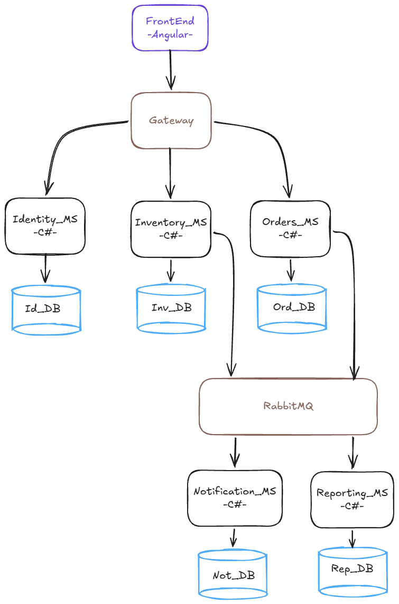

# StockSync

Multi-tenant SaaS inventory, orders, identity, and reporting platform built with microservices using **.NET 8**, **TypeScript/NestJS**, **PostgreSQL 15**, and **RabbitMQ**.

## Available Services

| Service | Docker Port | Swagger UI | Language |
|---|---|---|---|
| **API Gateway** | `9090` | <http://localhost:9090/swagger> | TypeScript / NestJS |
| **Inventory Service** | `5001` | <http://localhost:5001/swagger> | .NET 8 (English) |
| **Identity Service** | `5002` | <http://localhost:5002/swagger> | .NET 8 (English) |
| **Orders Service** | `5003` | <http://localhost:5003/swagger> | .NET 8 (English) |
| **Reporting Service** | `5004` | <http://localhost:5004/swagger> | .NET 8 |

For dedicated service documentation:

- [Inventory Service Documentation](#inventory-rules)
- [Identity Service Documentation](IdentityService/README.md)
- [Orders Service Documentation](#orders-service)
- [Reporting Service Documentation](ReportingService/README.md)
- [API Gateway Documentation](ApiGateway/README.md)

## Run with Docker

Start Docker Desktop, then run from the repository root:

```sh
cp -n .env.example .env
docker compose up -d --build
```

Open **http://localhost:9090/swagger** for Inventory Swagger. Query Reporting under `/api/reports` on port 9090 or open its Swagger on port 5004. PostgreSQL uses host ports 5432 (Inventory), 5433 (Identity), 5434 (Orders) and 5435 (Reporting). RabbitMQ uses port 5672 for AMQP and 15672 for its management UI.

Each API waits for its PostgreSQL database and applies pending migrations. Inventory and Identity load demo data when enabled. Repeated startup does not reset stock balances. Configure `POSTGRES_PASSWORD`, `LOAD_DEMO_DATA`, `GATEWAY_PORT` and `GATEWAY_TENANT_ID` in the root `.env`.

```sh
docker compose logs -f inventory-api  # Ctrl+C exits the log viewer.
docker compose stop                 # Stop services and preserve data.
docker compose up -d --build         # Rebuild after source changes.
```

`docker compose down -v` also deletes the database volume. Use it only when intentionally resetting local data.

The image enables `Initialization__ApplyMigrations=true`. With multiple API replicas, disable startup migrations and run `docker compose run --rm inventory-api --migrate` once before starting the replicas. Demo data is controlled by `Initialization__LoadDemoData` and is allowed only in Development.



ReportingService is implemented. Notification remains planned.

## Run locally

Install an SDK with the .NET 8 runtime and start PostgreSQL on `localhost:5432`:

```sh
docker compose up -d inventory-db
cd InventoryService
dotnet tool restore
dotnet restore
ASPNETCORE_ENVIRONMENT=Development dotnet ef database update \
  --project StockSync.Inventory.Infrastructure \
  --startup-project StockSync.Inventory.WebApi

dotnet run --project StockSync.Inventory.WebApi --launch-profile http -- --seed
dotnet run --project StockSync.Inventory.WebApi --launch-profile http
```

Local Swagger is at http://localhost:5041/swagger. Docker exposes the direct API at port `5001` instead. Local migrations and seeding are explicit commands; ordinary `dotnet run` does not perform them automatically. Connection strings are configured through `ConnectionStrings__DefaultConnection` or development appsettings.

### Inventory movement events

Inventory saves its events in the same transaction as stock movements. Configure `RabbitMq__ConnectionString` to enable the API's background publisher. Pending events remain in the outbox when the broker is unavailable or the connection string is unset.

After applying migrations, run `dotnet run --project StockSync.Inventory.WebApi -- --backfill-events` from `InventoryService` to enqueue existing stock movements across all tenants. The command exits after enqueueing. Each event keeps the movement's original date, ID and balances, and uses current product metadata, including for inactive products. Movements whose product cannot be resolved are logged and skipped. Repeated runs preserve existing outbox records. Startup with `Initialization:LoadDemoData` enabled also backfills once after seeding.

If macOS selects a .NET installation without the .NET 8 runtime, select the installation that contains it:

```sh
export DOTNET_ROOT=/usr/local/share/dotnet
export PATH="$DOTNET_ROOT:$PATH"
dotnet --list-runtimes
```

See [the gateway README](ApiGateway/README.md) for running the gateway with Node.js 24.

## Public routes

The gateway maps `/api/inventory/...` to `/api/...` on Inventory and preserves Orders and Reporting paths.

| Gateway route | Purpose |
| --- | --- |
| `/api/inventory/products` | Product creation, updates, listing and soft deletion |
| `/api/inventory/categories` | Categories and category products |
| `/api/inventory/stock` | Product/branch assignments and quantity adjustments |
| `/api/inventory/stock/branch/{branchId}` | Stock assigned to a branch |
| `/api/inventory/stock/product/{productId}` | Stock assigned to a product |
| `/api/inventory/stock/low-stock?branchId=...` | Active-product stock below its minimum |
| `/api/inventory/stock/{stockId}/receipts` | Receive stock |
| `/api/inventory/stock/{stockId}/issues` | Issue stock |
| `/api/inventory/stock/{stockId}/movements` | Stock movement history |
| `/api/inventory/movements` | Latest 10 movements across all stocks |
| `/api/inventory/movements/page/{page}` | Subsequent pages of 10 movements |
| `/api/orders`, `/api/purchase-orders` | Sales and purchase order workflows |
| `/api/reports/sales` and subpaths | Sales summary, daily totals, top products and paginated sales |
| `/api/reports/purchases/summary`, `/api/reports/purchases/daily` | Received purchase totals |
| `/api/reports/inventory/movements/summary` | Movement totals by type, UTC day and product |
| `/api/reports/inventory/low-stock` | Latest known balances below minimum, paginated |

Product requests use `name`, `sku`, `description`, `purchasePrice`, `salePrice`, `minimumStock` and `categoryId`. Stock creation uses `productId`, `branchId` and `quantity`; a manual update uses `newQuantity`. Receipt and issue requests use `quantity`.

List responses contain `items`, `page`, `pageSize`, `total` and `totalPages`. Lists accept `page` (at least 1) and `pageSize` (1–100, default 20), except the general movement list, which always uses pages of 10. Empty pages return 200 with an empty `items` array.

The general movement list is ordered by descending date and ID. Each item contains `productName`, `productSku`, `productId`, `stockId`, `branchId`, `type`, `quantity`, `previousQuantity`, `newQuantity` and `date`. Names and SKUs reflect current product data; inactive products remain in history.

## Demo data

`InventoryDbSeeder` creates two categories, three products, three stock assignments and five movements through Entity Framework and domain methods. A single transaction saves them in the default tenant. Seeding looks up active categories by normalized name, products by SKU (preferring an active match), and stock by product/branch. It does not reactivate products, reset balances or duplicate movements for existing assignments.

| SKU | Product | Balance | Example |
| --- | --- | --- | --- |
| `DEMO-HER-001` | Demo hammer | 7 | Receipts, issues and history |
| `DEMO-HER-002` | Demo drill | 0 | Issue rejected with HTTP 409 |
| `DEMO-PAP-001` | Demo notebook | 12 | Initial balance recorded as an adjustment |

The first two assignments use branch `11111111-1111-1111-1111-111111111111`; the third uses `22222222-2222-2222-2222-222222222222`. Branches belong to another service and are not modeled as inventory tables. SKU identifiers remain stable across the language migration.

```sh
curl http://localhost:9090/api/inventory/products
curl http://localhost:9090/api/inventory/categories
curl http://localhost:9090/api/inventory/stock/branch/11111111-1111-1111-1111-111111111111

# Replace with an actual stock ID.
stock_id='STOCK_ID'
curl "http://localhost:9090/api/inventory/stock/$stock_id/movements"
curl -i -X POST "http://localhost:9090/api/inventory/stock/$stock_id/issues" \
  -H 'Content-Type: application/json' -d '{"quantity":1}'
```

The [HTTP examples](InventoryService/StockSync.Inventory.WebApi/StockSync.Inventory.WebApi.http) cover the complete flow against the direct local API.

## Inventory rules

- Categories and products use soft deletion (`isActive = false`). Category names and SKUs are unique among active records within a tenant and can be reused after deactivation. History references product IDs, not SKUs.
- Movement types are `Receipt`, `Issue` and `Adjustment`. Initial balances and manual quantity changes create adjustments. An unchanged balance creates no movement.
- Issues exceeding the available balance return 409. Row locks serialize concurrent operations on the same stock; optimistic concurrency also protects stale writes.
- Categories with active products, products with remaining stock, and stock assignments with units or history cannot be deleted. Inactive products cannot receive movements or adjustments.
- Low-stock results contain active products with `quantity < minimumStock`, ordered by descending `shortage`. A zero minimum never produces an alert.

| Status | Meaning |
| --- | --- |
| 400 | Invalid input, including a missing or inactive product/category referenced in a body |
| 404 | A URL resource does not exist or is inactive |
| 409 | Duplicate data, insufficient stock, or an operation forbidden by the current state |

## Multitenancy

Categories, products, stock and movements belong to a tenant identified by the `X-Tenant-Id` GUID header. Tenants cannot read or reference each other's records. The direct API requires the header unless `Multitenancy:RequireHeader` is false, as configured in Development. When optional, omission uses `00000000-0000-0000-0000-000000000001`.

The gateway overwrites the caller's `X-Tenant-Id`. Orders always uses the configured development `TENANT_ID`. Inventory and Reporting use the bearer JWT's `tenant_id` or `TenantId` claim and fall back to `TENANT_ID` when no usable claim is present. The gateway does not verify the JWT signature.

## English migration

This branch changes public routes, JSON fields, query parameters, movement values, configuration keys, source identifiers and documentation to English. Existing clients must adopt the contracts above. Rename the root environment setting to `LOAD_DEMO_DATA` when upgrading an existing `.env`.

`TranslateSchemaToEnglish` renames tables, columns, indexes and constraints in place and converts stored movement types. It preserves IDs, tenant ownership, quantities and history, with a reverse migration available. Stop older API instances before applying it because the schema and contracts change together.

Historical migrations and their old database names are intentionally retained so existing migration histories remain valid. Legacy names also appear in the upgrade/rollback migration because those are the objects it must rename. Existing user-entered product names and descriptions are data and are not automatically translated.

## Orders service

`OrdersService/` manages sales orders and supplier purchase orders with its own database (`stocksync_orders`). In Docker the direct API is http://localhost:5003/swagger; locally it runs on http://localhost:5045 with `dotnet run --project StockSync.Orders.WebApi --launch-profile http` from `OrdersService` (start `orders-db`, `rabbitmq` and InventoryService first, then run `dotnet ef database update --project StockSync.Orders.Infrastructure --startup-project StockSync.Orders.WebApi` with `ASPNETCORE_ENVIRONMENT=Development`). The gateway forwards `/api/orders` and `/api/purchase-orders` unchanged. RabbitMQ management is at http://localhost:15672 (`RABBITMQ_USER` / `RABBITMQ_PASSWORD`, default `stocksync`).

| Route | Purpose |
| --- | --- |
| `POST /api/orders` | Create a draft sale for a branch (`branchId`, `notes`) |
| `GET /api/orders/{id}`, `GET /api/orders` | Get one order; list with `status`, `branchId`, `from`, `to`, `page`, `pageSize` |
| `POST /api/orders/{id}/lines` | Add a product (`productId`, `quantity`); the price is the Inventory `salePrice` |
| `PUT` / `DELETE /api/orders/{id}/lines/{lineId}` | Change the quantity or remove a line while in draft |
| `POST /api/orders/{id}/confirm` | Issue stock in Inventory and confirm the sale |
| `POST /api/orders/{id}/cancel` | Cancel a draft sale |
| `/api/purchase-orders/...` | Same operations with `supplierName`; prices use the Inventory `purchasePrice`; `place` sends the order and `receive` records stock receipts |

Order statuses are `Draft`, `Confirming`, `Confirmed`, `RequiresReview` and `Cancelled`. Purchase order statuses are `Draft`, `Ordered`, `Receiving`, `Received`, `RequiresReview` and `Cancelled`. Lines can change only in draft; a product appears once per document; quantities and prices must be greater than zero; totals are calculated by the domain. Confirmed sales cannot be cancelled (returns are not implemented).

### Stock consistency

Inventory has no batch or idempotent movement endpoint, so confirmation is an orchestrated saga with compensation and no changes to Inventory:

1. The order is locked and moved to `Confirming` in its own transaction, which blocks edits and a second confirmation.
2. Orders calls `POST /api/stock/{stockId}/issues` for each line and saves the returned movement ID after every call.
3. If Inventory refuses a line (for example insufficient stock, 409), the issued lines are reversed with `receipts`, the order returns to `Draft` and the API answers 409. If Inventory cannot be reached before anything is issued, the order returns to `Draft` with 503.
4. If a result is unknown (timeout, 5xx or a lost connection after sending), Orders never retries, because a retry could issue stock twice. The order moves to `RequiresReview` with the reason, the API answers 503, and a person reconciles it with the movement IDs stored on each line and the Inventory movement history.

Receiving a purchase order uses the same saga with receipts, compensated with issues. Calls go directly to `http://inventory-api:8080` with the caller's `X-Tenant-Id`; the request is not cancelled halfway even if the client disconnects.

## Reporting service

ReportingService projects confirmed sales, received purchase orders and inventory movements into its own PostgreSQL database, `stocksync_reporting`. Orders and Inventory commit events through their transactional outboxes and publish to RabbitMQ's `stocksync.events` exchange. Reporting uses separate durable queues for sales, purchases and stock movements. Delivery is at least once and Reporting deduplicates by event ID. Report data becomes visible after the outbox publisher and consumer finish processing it.

Orders also publishes `orders.order-created.v1` for draft sales. Sales and purchases provide commercial totals. Inventory movements drive inventory reporting, including saga compensation movements. See [integration event contracts and development replay](docs/integration-events.md) and the [ReportingService runbook](ReportingService/README.md).

## Inventory service checks

From `InventoryService`:

```sh
dotnet test StockSync.Inventory.sln

# Requires a PostgreSQL role with CREATE DATABASE permission.
STOCKSYNC_TEST_POSTGRES='Host=localhost;Database=postgres;Username=postgres;Password=stock1234' \
  dotnet test StockSync.Inventory.sln
```

Run the same commands from `OrdersService` or `ReportingService` with the corresponding solution. Without that variable, PostgreSQL integration checks are skipped. Each integration check creates and removes its own database rather than changing application data. The gateway has no test directory; use `npm run typecheck` and `npm run build` to check it.
